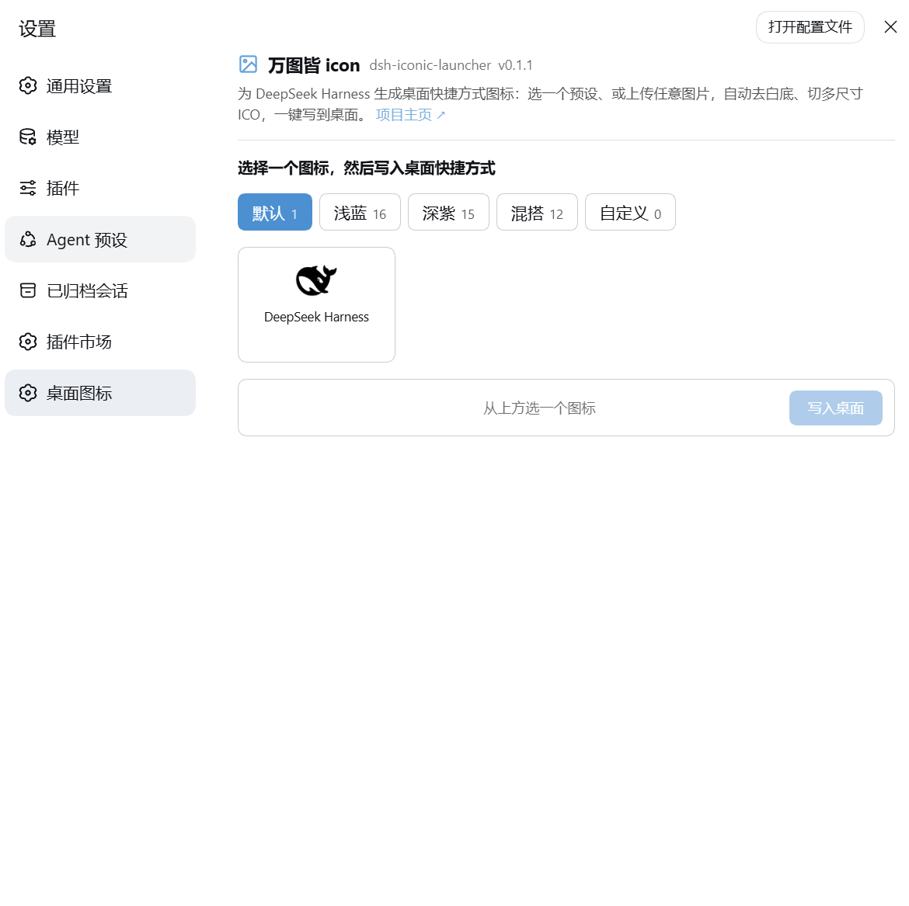
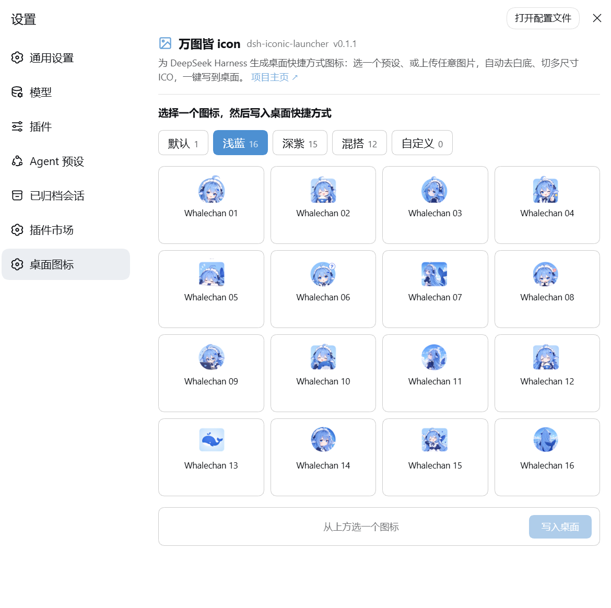
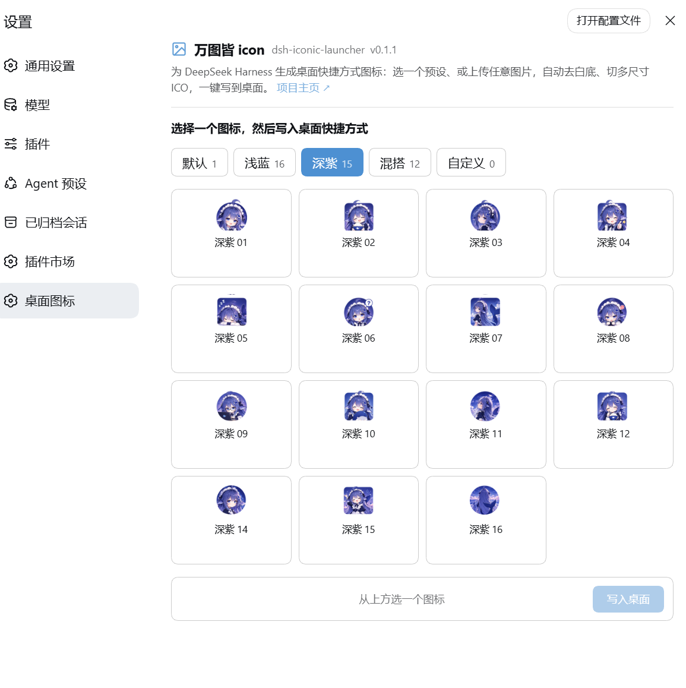
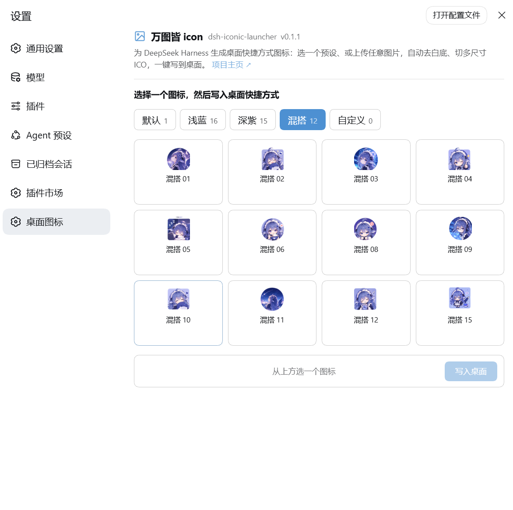
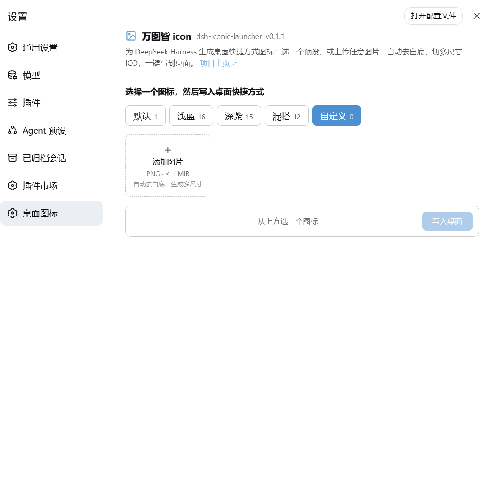

# dsh-iconic-launcher · 万图皆 iConic

[](#requirements--环境)
[](LICENSE)
[](#install--安装)

> **DeepSeek Harness is 「万物皆插件」 — everything is a plugin.**
> **This is its corollary: 「万图皆 iConic」 — every image can be an icon.**
>
> DSH 的设计哲学是「万物皆插件」：没有什么是写死的，一切都能以插件的形式被替换、被扩展。
> 这个项目是同一句话在图标上的对仗——「万图皆 iConic」（iConic = iconic + icon）。
> 上游把桌面快捷方式的图标当成一个固定资产烤进安装包；我们把它变成一件
> **由插件提供、由你决定的表面**：44 个内置预设任选，或者丢进任意一张图片，
> 去白底、切多尺寸、一键写回桌面。图标不再是产品的皮肤，而是你的。

A desktop-icon plugin for the **DeepSeek Harness desktop client** on Windows. Pick a
shipped preset or upload any PNG; the plugin knocks the white plate out of it, packs a
7-resolution `.ico`, and rewrites the client's own desktop shortcut with that icon — no
build step, no core-code changes.

为 **DeepSeek Harness 桌面客户端**（Windows）提供桌面快捷方式图标定制：从内置预设挑一个，
或上传任意 PNG；自动去除白底、打包成 7 个分辨率的 `.ico`，一键写回客户端自己的桌面快捷方式。
零构建、不改动上游一行核心代码。

---

## Preview / 预览

<table>
  <tr>
    <td align="center" width="50%">
      
      <br><sub><b>默认 / Default</b> — 顶部项目信息 + 品牌图标</sub>
    </td>
    <td align="center" width="50%">
      
      <br><sub><b>浅蓝 / Light blue</b> — 16 个预设</sub>
    </td>
  </tr>
  <tr>
    <td align="center" width="50%">
      
      <br><sub><b>深紫 / Deep purple</b> — 15 个预设</sub>
    </td>
    <td align="center" width="50%">
      
      <br><sub><b>混搭 / Mixed</b> — 12 个预设</sub>
    </td>
  </tr>
  <tr>
    <td align="center" colspan="2">
      
      <br><sub><b>自定义 / Custom</b> — 上传入口，上传过的图会留在这里（可删除）</sub>
    </td>
  </tr>
</table>

五张截图对应设置页的五个分组，全部取自真实的桌面客户端设置界面。
All five tabs of the settings surface, captured from the real desktop client.

---

## Why this exists / 初衷

**The shortcut is the outermost shell of the product — and it was the one part you could not change.**
A desktop app's shortcut icon is the first and last thing a user sees: it is the thing you
double-click every day, and the thing your taskbar and Alt-Tab inherit. Upstream ships exactly
one of them, baked into the installer. This plugin takes that single, hard-coded surface and
makes it a **plugin-provided, user-owned** one — the same move DSH makes for everything else
with 「万物皆插件」.

**快捷方式是产品最外层的那张脸，却恰恰是唯一改不动的地方。** 桌面应用的快捷方式图标是用户
每天第一眼和最后一眼看到的东西，也是任务栏、Alt-Tab 继承的东西。上游只发一个，烤死在安装包里。
这个插件做的就是把这张「写死的脸」变成一块**由插件提供、由用户决定**的表面——正是 DSH 用
「万物皆插件」对待其它一切的方式。

Two things follow from that, and they are deliberate design constraints, not limitations:

- **It lives outside the upstream repository.** The upstream tree stays upstream-clean: nothing
  is patched, forked, or rebuilt. Delete this repo and DSH is byte-for-byte as shipped.
- **It is a real DSH plugin, not a one-off script.** That means it is installable from the
  client, reversible on teardown, and its behaviour is declared in config — not hidden in some
  machine-local `.bat` file. (The `scripts/` folder in this repo is the *earlier* incarnation and
  is kept only as history — see [Legacy toolchain](#legacy-toolchain--早期脚本).)

由此得出两条刻意的设计约束，而非缺陷：

- **不在上游仓库里。** 上游永远保持干净：不打补丁、不 fork、不重新构建。删掉本仓库，DSH 与
  官方发布逐字节相同。
- **它是真正的 DSH 插件，不是一次性脚本。** 因此可从客户端安装、卸载时干净回滚、行为写在
  配置里，而不是塞进某个本机的 `.bat`。（`scripts/` 是**早期形态**，只作历史保留，见下文。）

---

## What it does / 功能

| Capability | 说明 |
|---|---|
| **44 shipped presets** in 4 groups | 默认 / 浅蓝 16 / 深紫 15 / 混搭 12，全部为离线预生成的多尺寸 `.ico`，运行时零栅格化开销。 |
| **Upload any PNG / JPEG / WebP** | 上限 1 MiB；客户端画布解码并重编码为 PNG，host 无需任何图像库。 |
| **Automatic backdrop removal** | 从四条边框向内 flood-fill 白色底板，再对边缘做 2 步羽化重算 alpha。不做全局白→透明，否则会打穿图像里的白色部分。 |
| **7-resolution ICO** | 256 / 128 / 64 / 48 / 32 / 24 / 16，单文件多尺寸，Windows Vista+ 原生支持 PNG 压缩条目。 |
| **One-click `.lnk` rewrite** | 写的是客户端**自己那个**快捷方式，不是并排新建一个。 |
| **Bounded work per upload** | 画布长边上限 1024，超出自动降采样——否则超大图会让 flood fill 按像素数爆炸，把标签页卡死。 |
| **Custom icons persist** | 上传的图会存成自定义预设，下次打开仍在「自定义」分组里，带两段式点击删除。 |
| **Content-addressed icon files** | 图标文件名带内容哈希，专门用来绕过 Windows 按**路径**索引的图标缓存。 |
| **No build step** | 纯 JS，从客户端装（见 [Install](#install--安装)）即生效；无 tsdown、无打包、无编译。 |

---

## Install / 安装

> **Platform / 平台**：**Windows 10/11 only**。快捷方式是 `.lnk` + PowerShell，其它平台
> 可以安装但写入快捷方式不可用（host 侧会明确报错，而不是静默失败）。

### 1. 在桌面客户端里安装

打开客户端的 **插件** 页面（插件市场 / 插件配置 / Plugins），添加本仓库为来源：

```
github:SkyblueeeLabs/dsh-iconic-launcher
```

### 2. 重启客户端，然后打开 设置 → 桌面图标

在 **设置 → 桌面图标** 里选预设或上传图片，点「写入桌面」。快捷方式会落在桌面，并直接启动
客户端本身。同样的卡片也出现在 **插件 → 插件配置** 里（默认折叠）。

Restart the desktop client, then open **Settings → 桌面图标** and pick or upload an icon. The
same card is also mounted, collapsed by default, on the Plugins page.

### ⚠️ 命令行装不了 desktop profile

```text
dsh plugin --profile desktop add …    # ✗ 会被拒绝
# profile "desktop" is managed exclusively by the Electron application
```

`desktop` profile 由桌面客户端独占，CLI 会直接拒绝。**请走客户端自己的插件管理界面。**

### Releases 里的 `.tgz` 与 `main` 同步

`v0.1.2` 起，GitHub **Releases** 上的 `.tgz` 与 `main` 的代码一致。离线安装用 Releases 里最新的
`.tgz` 即可；从当前 clone 里 `npm pack` 产出的是同一个包。

> **Historical note / 历史说明**：`v0.1.1` 的 tarball 早于"只服务桌面版"的改动，它的快捷方式目标
> 仍是已废弃的 `powershell -Command "dsh web"`，且缺少 `launcher.js`。如果你还持有那个旧包，
> 请升级到 `v0.1.2`。
>
> The `v0.1.1` asset predates the desktop-only switch and writes a shortcut that runs the
> retired `dsh web` command. Upgrade to `v0.1.2`.

### 客户端更新会重置图标

客户端安装包在更新时会**重建它自己的**桌面快捷方式，把图标换回默认。插件本体与已选图标都在
用户数据目录里（`~/.dsh/profiles/desktop/node_modules/dsh-iconic-launcher` 与
`~/.dsh-launcher/icons`），更新不会动它们。所以更新后**不需要重装插件**，只要重新打开
**设置 → 桌面图标** 再选一次图并写入即可（约两秒）。卡片目前不记忆上次选择，重新选同一张图就行。

---

## Use / 使用

1. 打开 **设置 → 桌面图标**。
2. 选一个分组（默认 / 浅蓝 / 深紫 / 混搭 / 自定义）。
3. 点一个图标 —— 底部确认栏会显示它的缩略图和名字，**写入前你会清楚看到要写什么**。
4. 或切到「自定义」点「＋ 添加图片」上传 PNG / JPEG / WebP，处理完直接点「写入桌面」。
5. 点 **写入桌面** —— 成功后会显示 `.lnk` 的落地路径。

失败时错误信息就地显示在确认栏里（不是弹窗），因为嵌入式 webview 常吞掉模态框。

---

## Presets / 预设

| Group | 数量 | Source batch | 命名 |
|---|---:|---|---|
| 默认 Default | 1 | 品牌图标（源自 DSH favicon，MIT） | `dsh-brand` |
| 浅蓝 Light blue | 16 | `data/1` | `whalechan-icon-NN` |
| 深紫 Deep purple | 15 | `data/2` | `whalechan-deep-purple-NN` |
| 混搭 Mixed | 12 | `data/3` | `whalechan-varied-NN` |
| 自定义 Custom | 动态 | 用户上传，目录扫描 | `custom-<slug>-<epoch-ms>` |

共 **44** 个内置图标。序号沿用源批次的原始编号，因此出现跳号是**故意的**（对应源目录里
被移除的文件），不是漏资源。

44 built-in icons. Numbering follows the source batch, so gaps are intentional — not missing files.

---

## How it works / 原理

两部分，装成同一个插件行：

- **Host half**（`index.js`）是一个 cordis function plugin：在 composition 的 `webServer` 上挂
  4 条路由，向 `settings` 注册命名空间，使插件页会为该命名空间渲染卡片。
- **Browser half**（`client.js`）不是 ES module，而是手写成 `window.__ModuleLoader__.load({...})`
  形式——这是 no-build 插件的硬性要求。一个顶层 `import` 会让整个客户端插件批次
  `SyntaxError` 挂掉。

| Method | Route | Purpose |
|---|---|---|
| `GET` | `/dsh-launcher-ic/presets` | 预设目录 + 安装目标 + 项目元信息 |
| `GET` | `/dsh-launcher-ic/icon/<group>/<preset>` | 单个预设的 `.ico` 字节（预览用，prefix 路由） |
| `POST` | `/dsh-launcher-ic/install` | 写入 / 刷新桌面快捷方式 |
| `POST` | `/dsh-launcher-ic/custom-delete` | 删除一个用户上传的自定义图标 |

上传管线全程在浏览器里跑，因为 host 进程没有任何栅格化器：

```
任意图片（PNG / JPEG / WebP）→ createImageBitmap 解码（浏览器原生解码器）
    → 长边超过 1024 则降采样，再放进方形 letterbox 画布（透明补边，绝不补白）
    → knockOutWhiteBackdrop()：四边 flood-fill 白底板 + 2 步羽化
    → 按 ICON_SIZES 逐个重采样 → 每个尺寸重编码为一张 PNG
    → POST /install → host 校验（PNG 签名、尺寸白名单、体积上限）
    → buildIco() 打包 → 内容寻址写入 → shortcut.ps1 写 .lnk
```

快捷方式的**目标在运行期解析**（`launcher.js`）：桌面外壳以 `ELECTRON_RUN_AS_NODE=1` + 应用
自身 exe 启动 host，所以 `process.execPath` 就是启动器；解析不出来时安装路由返回 `no-target`
并且**什么都不写**——宁可失败，也不留一个指向虚空的链接。

架构细节、路由契约与安全边界见 **[`docs/plugin.md`](docs/plugin.md)**。

---

## Configuration / 配置

`cordis.patch.yml` 随包分发，安装时作为 bundle patch 生效：

| Field | Default | 说明 |
|---|---|---|
| `shortcutName` | `DeepSeek Harness`（schema 默认 `DeepSeek Launcher`） | `.lnk` 基名，不带扩展名 |
| `targetExecutable` | *(空 = 托管它的桌面应用)* | 仅用于覆盖启动目标 |
| `targetArguments` | `''` | 加到目标上的命令行参数 |
| `workingDirectory` | *(目标自身目录)* | 快捷方式工作目录 |
| `iconDir` | `%USERPROFILE%\.dsh-launcher\icons` | 生成的 `.ico` 落地目录 |
| `customDir` | *(空 = `iconDir\custom`)* | 用户上传图标的持久化目录 |
| `desktopDir` | `%USERPROFILE%\Desktop` | `.lnk` 落地目录 |
| `allowUpload` | `true` | 设 `false` 则只允许预设 |

`shortcutName` **故意等于客户端自带的快捷方式名**：这样「安装图标」是**替换那个快捷方式的外观**，
而不是在桌面并排多出一个同名项。`cordis.patch.yml` 里不含任何机器相关的可执行路径。

---

## Requirements / 环境

- **Windows 10/11**
- **PowerShell 5.1+**（或 PowerShell 7）
- 正在运行的 **DeepSeek Harness 桌面客户端**（插件装在它保留的 `desktop` profile 里）
- 开发时额外需要：**Node.js**（跑 `node --test`），无其它构建依赖

---

## Security & privacy / 安全与隐私

- **每条路由第一件事**就是向 composition 的 `connection` 服务要一次 `requestRejection`：Host/Origin
  栅栏挡住 DNS rebinding 与跨站调用，浏览器登录态再挡一层。与官方 `dsh-host-open-in-app` 同一套围栏。
- **进入磁盘前在 wire 层校验**：`application/json` 媒体类型、有界请求体、净化过的快捷方式基名
  （拒绝 Windows 设备名、超长名、安全字母表以外的字符）、上传必须是真实 PNG 签名。
- **删除路由额外收紧**：id 必须是单个安全路径段，且解析后的绝对路径必须严格落在 `customDir` 内；
  出厂预设不可寻址，因此不存在越界删除的路径。这是插件里唯一的破坏性操作。
- **不外传任何东西**：没有遥测、没有网络请求。除配置的两个目录（图标目录、桌面目录）之外不读也不写
  其它文件，产物全部落在 `%USERPROFILE%` 下。

No telemetry, no network calls, no reads outside the paths you configure.

---

## Where your files go / 文件落在哪

```
%USERPROFILE%\.dsh-launcher\icons\
  DeepSeek Harness.<sha10>.ico     ← 当前图标（名字带内容哈希）
  custom\
    custom-<slug>-<epoch-ms>.ico   ← 每次上传持久化成一个自定义预设
%USERPROFILE%\Desktop\
  DeepSeek Harness.lnk             ← 桌面快捷方式
```

**为什么文件名带哈希？** Windows 的图标缓存按**路径**索引。原地覆盖 `<name>.ico` 会让桌面继续显示
旧位图，尽管 `.lnk` 的 `IconLocation` 已经指向新内容（属性对话框直接读文件，所以那边立刻是新图）。
每次内容变化换一个新路径，缓存就必然 miss；写入后还会顺手删掉同基名的旧文件，并调用
`SHChangeNotify(SHCNE_UPDATEITEM, SHCNF_PATHW, lnk)` 通知 Explorer 立刻重绘。

---

## Legacy toolchain / 早期脚本

> 这一节讲的是**仓库里保留的历史形态**，不属于安装后的插件，也不要用于新环境。

本仓库还留着最初 `dsh web` 时代的便携启动工具链：`scripts/`（启动 `.bat`、图标生成、PNG→ICO 批量
转换）、`data/`（PNG 素材源）、`deploy.ps1`（重克隆后一键恢复）、`install.ps1`（新机器一键安装）。
它们全部**不在 npm 包里**（`package.json` 的 `files` 明确排除），只作为历史与素材保留。

插件形态取代它的原因很直接：脚本是本机文件、重克隆即失效、机器路径写死在文件里；而插件是可安装的、
配置声明的、卸载可回滚的。**新装用户请忽略这一段，只按上面的 Install 一节操作。**

The `scripts/` + `data/` + `deploy.ps1` + `install.ps1` toolchain is the earlier `dsh web` incarnation.
It is kept for history and as icon source material, is **not** shipped in the npm package, and is not
maintained for new setups.

---

## Repo layout / 目录

| Path | 角色 |
|---|---|
| `index.js` | Host half：4 条 `webServer` 路由 + `settings` 命名空间注册 |
| `client.js` | Browser half：设置卡片（无构建，`__ModuleLoader__` 形式） |
| `shared.js` | 前后端共享的路由常量与 wire 契约 |
| `presets.js` | 分组预设目录 + 出货 `.ico` 加载 + 自定义目录扫描 |
| `ico.js` | PNG → 多尺寸 `.ico` 打包（ICONDIR + ICONDIRENTRY） |
| `desktop.js` | 经 `ctx.subprocess` 调 `shortcut.ps1` 写 `.lnk` |
| `launcher.js` | 运行期解析「快捷方式该启动谁」（纯函数，可单测） |
| `shortcut.ps1` | 实际写 `.lnk` 的脚本 + `SHChangeNotify` 刷新 |
| `cordis.patch.yml` | bundle patch：安装时 insert 插件行与默认配置 |
| `presets/assets/` | 44 个出货 `.ico` + 品牌 SVG |
| `assets/screenshots/` | 五张设置界面截图（+ `screenshots.json` 声明） |
| `test/` | Node 内置 test runner 单测（8 个用例） |
| `docs/` | [`plugin.md`](docs/plugin.md) 技术细节 · [`HANDOFF.md`](docs/HANDOFF.md) 交接 |
| `scripts/` `data/` | **早期工具链与素材源，不进包** |

---

## Development / 开发

```powershell
# 单测（启动参数绑定 + 启动目标解析，不需要 DSH 依赖）
npm test
# = node --test --test-isolation=none test/*.test.mjs

# 从当前 clone 生成离线包
npm pack        # → dsh-iconic-launcher-<version>.tgz
```

没有构建步骤：改完 JS 直接重装即可。所有注册都包在 `ctx.effect()` 里，因此重载与卸载会自然回滚。

---

## FAQ / 常见问题

**桌面图标没变？** 图标缓存。插件的文件名是内容寻址的，正常路径下不该发生；如果确实遇到，重启
Explorer 或重新写入一次即可。

**桌面上出现两个 DeepSeek Harness？** 不会——`shortcutName` 就是客户端自带那个快捷方式的名字，
安装是**改写**它。如果你手动改过 `shortcutName`，才会多出一项。

**能上传 JPEG / WebP 吗？** 能（自 v0.1.2 起）。浏览器负责解码，PNG / JPEG / WebP 都收，上限 1 MiB；
无论输入什么格式，写入前都会统一重编码为 PNG 再打包进 `.ico`。超大的图（长边 > 1024）会自动降采样，
不会被拒绝——因为长边 1024 已经是最大图标尺寸 256 的 4 倍，足够清晰。浏览器解码不了的格式（SVG、HEIC 等）
会给出明确提示，而不是静默失败。

**macOS / Linux 呢？** 装得上，但写快捷方式用不了（host 会明确返回平台错误）。未来方案是新增
`.icns` 生成器与 macOS 的 `.app` 写入器，而不碰 Windows 路径。

**卡片会记住我上次选的图标吗？** 不会。所以客户端更新后，重新选同一张图即可。

**这会不会污染 DSH 上游？** 不会。插件在独立仓库、独立 profile 依赖里，上游零改动。

---

## Docs map / 文档分工

- [`README.md`](README.md) — 对外说明：它是什么、为什么存在、怎么装怎么用（用户与收录页看这里）
- [`docs/plugin.md`](docs/plugin.md) — 技术细节：路由契约、配置项、安全边界、当前状态
- [`docs/HANDOFF.md`](docs/HANDOFF.md) — 交接手册：架构、真踩过的坑、profile 切换流程、遗留任务

---

## License

MIT。默认图标源自 DeepSeek Harness 自己的 favicon（MIT）。
